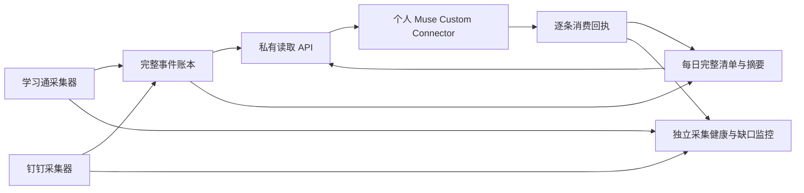

# Muse Tunnel 可行性调研

调研日期：2026-10-09（Asia/Shanghai）。基线：Student-Agent `cace0b9e3395626fba8b5e1796a689d98bc31b5c`；本地分支 `muse-tunnel`。本次为静态代码检查和官方文档调研，没有登录真实账号、运行采集器或验证 Muse 消费流程。

## 1. 结论

可以把 Student-Agent 的采集能力改造成专供 **Meta 个人 AI Agent Muse** 读取的信息服务。推荐用私有 Custom Connector 接受 Muse 的拉取请求，并提供独立的消费回执接口。不要把调用 Muse Spark Model API 当成给现有个人 Muse 投递信息：它是模型推理平台，不能据此推断能写入用户 Muse 的会话或记忆。

三个要求的可行性不同：

| 要求 | 判断 | 必须接受的边界 |
| --- | --- | --- |
| 抓到的信息不因 tunnel 故障丢失 | 可做成持久化、可重试、可对账 | 需要事务日志、备份和恢复演练；硬件损坏的损失窗口取决于备份策略 |
| 学习通/钉钉所有信息都抓到 | 目前不能承诺 | 非公开接口、权限、历史保留、客户端缓存、撤回和附件有效期都可能形成盲区 |
| Muse 不漏读 | 可检测未回执、持续提供重放 | Muse 是否定时运行、是否准确理解和长期记住每条信息，不能由服务端证明 |
| 只给自己的 Muse 读取 | 可限制为一个授权消费者 | 凭据持有者可访问；真正绑定特定 VM 需要平台支持且须实测；Meta 的运行和推理环境仍在信任边界内 |
| 每天 double check | 可实现 | 必须用完整清单与回执做差集；自然语言摘要不能证明完整性 |

建议把“必须不漏”落实成：**所有已采集内容都可重放；每条都有消费状态；每个未能验证的采集窗口都会显式显示为缺口；不把未知状态报成完整。**

## 2. Muse 的真实接入能力

Meta 官方说明，个人 Muse 在独立的云端 VM 中运行，能通过 API/CLI 创建 Custom Connector。帮助中心明确允许用户在聊天中要求 Muse 创建自定义连接器，凭据由 Secure Credentials Store 保存。[Meta 帮助中心](https://www.meta.com/help/artificial-intelligence/1687253048996149/)、[Muse 安全架构](https://research.meta.ai/blog/security-and-safety-for-ai-agents-our-approach-with-muse)

因此首选：给 Muse 一份无秘密的 API 说明，让它建立自定义连接器；在平台安全凭据流程中提供专用凭据。MCP 可以作为后续适配层，但个人账号对远程 MCP 的具体认证兼容性仍应实测，第一版不必依赖 MCP。

官方公开 Connector 平台要求描述端点、认证、scope、工具读写属性与错误处理；公开目录需要审核。个人私用没有必要先做目录提交。[Connector 指南](https://muse.ai/platform/docs)

本次未找到个人 Muse 的公开文档承诺以下事项：任意自定义连接器都支持主动唤醒、确定性轮询频率、每条数据持久化回执、指定个人会话的外部消息写入 API。官方称部分连接器可主动更新，不能推断所有 Custom Connector 都有这种能力。因此先用 Muse 的定时任务拉取，服务端持续保留未确认内容；唤醒与推送能力单独验证。

上线前需完成小型接入实验：

1. Muse 能通过 Custom Connector 认证并拉取分页数据。
2. Muse 能在持久化本地收件记录后调用 ACK；中断、重启后状态能恢复。
3. 定时运行是否受权限确认、配额、网络、休眠或产品调度影响。
4. ACK 属于写入消费元数据，必须按真实副作用声明；不能伪装成只读来绕过 Sentinel。
5. 撤销凭据后访问立即失败，超时未 ACK 会出现在独立告警中。

## 3. Student-Agent 可以复用什么，必须改什么

现有 FastAPI、SQLite、扫码登录、学习通解析、钉钉本地数据库读取、定时任务和健康检查可以复用。日程 Agent、LLM 信息筛选、提醒写入和 PWA 大部分不属于新产品核心；Muse 负责理解与规划，tunnel 负责收集、保留、交付和核验。

以下证据均来自上述基线，可通过仓库对应文件及行号核对：

| 位置 | 当前行为 | 对完整性的影响 |
| --- | --- | --- |
| `server-src/backend/app/services/chaoxing_service.py:1133–1186` | 默认探测前 12 个会话，每会话取 20 条；异常返回空列表 | 活跃会话、突发消息可能遗漏；空列表无法区分无消息和采集失败 |
| 同文件 `1021–1085` | 漫游请求 `start=-1,end=-1` 后截取近期消息；通知仅 `pnum=1` | 没有实现完整历史分页；离线积压不可保证补齐 |
| 同文件 `1192–1207` | 拉取后保存会话探测 signature | 拉取异常被转为空列表时，变化标记可能已被推进，影响重试 |
| `services/chaoxing_message_filter.py:207–250` | 噪声、陈旧、聊天、重复作业通知过滤；候选最后只取 40 条 | 是提炼流水线，不能作为全量账本 |
| `dingtalk/task.py:93–111` | 只存 `notify/interest`；以所有消息最大时间推进游标 | 被筛掉的内容不在完整消息表中；分类不应控制入库 |
| `services/message_audit.py:59–83` | 被丢弃消息仅保留 200 字预览，超容量清理 | drop audit 不能恢复被过滤的完整内容 |
| `dingtalk/dingtalk_service.py:452–459` | 全局 `createdAt > last_seen` 查询 | 晚到旧时间消息、同时间戳补写可能永久跳过 |
| `dingtalk/router.py:31–55` | 最新优先，最多 500 条，没有完整分页协议 | 消费者若直接推进时间游标，大积压会被跳过 |
| `tasks/notification_sender.py:90–110,278–290` | 晚间推送要求 40 字以内、不罗列全部，记忆最多 5 条 | 现有 daily summary 不满足本项目的完整核验需求 |

钉钉读取的是登录客户端的本地加密数据库，并尝试拼合 WAL，而非官方全量消息 API。`dingtalk_service.py:247–260,308–359` 对主库和 WAL 分别读取；已有 salt/提交边界处理，但不能据此证明活跃写入时获得一致快照。新版本要处理 checkpoint 竞争、验证稳定快照与校验和，失败不推进游标。SQLite 官方推荐在线备份获得数据库快照；加密客户端数据库能否通过兼容驱动使用备份 API 还需验证，不能直接假设可用。[SQLite Backup API](https://www.sqlite.org/backup.html)、[WAL 文件格式](https://www.sqlite.org/fileformat2.html)

## 4. 上游接入的限制

### 学习通

当前代码使用扫码会话、Web IM、漫游接口和通知接口，具有可复用的解析基础，但不是有稳定契约的个人全量数据 API。官方有第三方消息推送对接文档，需要平台分配秘钥和绑定关系；文档较旧，描述业务推送，不足以证明普通个人账号可以接入全部历史消息。[超星推送对接文档](https://auth.open.chaoxing.com/open/doc/list/yluywps0/zpsakobd/urxbijq2)

技术验证重点：所有会话枚举（包括折叠/归档）、历史分页边界和保留期、分页顺序、登录失效识别、通知正文/附件、作业详情、修改与撤回、图片/语音/文件类型。未验证分页之前，移除 `12/20` 上限也不等于全量支持。

### 钉钉

普通应用机器人在群内只能收到 @ 机器人的消息，单聊收到的是人与机器人的对话；不能用普通机器人替代个人账号的全量群消息采集。[钉钉官方开发者百科](https://open-dingtalk.github.io/developerpedia/docs/learn/bot/appbot/receive/)

现有本地客户端方案可作为 PoC，但只能证明“本地缓存中可读取的内容”。必须验证新群、离线积压、客户端未打开会话、历史加载、客户端升级、加密密钥变化、撤回、编辑及附件下载。若组织具备正式消息归档等能力，另行确认授权和覆盖范围；本次没有找到足以确认个人账号全量读取的官方 API 契约。

两端都应记录 `coverage=verified/partial/unknown` 及已验证的覆盖类型。已撤回且从未观察到、超出保留期、从未进入本地缓存的信息不能凭空恢复。

## 5. 推荐的数据链路与可靠性协议

### 采集先落库，理解后处理

- 对授权采集范围内的每条消息保存原始有效载荷、来源 ID、账号、会话、源时间、采集时间、类型、版本、正文和附件状态。Cookie/token 等传输凭据必须剔除。
- 唯一键优先用 `(source, account, conversation, source_message_id, revision)`；同文本的不同消息不得仅凭内容 hash 合并。缺稳定 ID 时标为低可信身份策略并验证碰撞。
- 新增、修改、撤回分别保存事件。不能把 `INSERT OR IGNORE` 当作更新处理；未知消息类型保存原始数据并排队解析。
- 事件和待消费记录同一事务提交，再推进采集检查点。解析失败也应留原始包和错误记录，不能当作无消息。
- 采集按会话/分区管理检查点，使用可验证的上游游标；轮询需重叠回扫、ID 去重、周期性全量对账。重叠窗口之外的迟到数据仍需全量对账弥补。
- 附件及时下载到私有存储，记录 hash、大小、媒体类型和状态。下载/解析失败重试并告警；保存正文不表示附件完整。OCR/ASR 是衍生数据，失败不影响原件保留。

### Muse 消费按入库序号分页

给每个消费者分配持久化序号 `seq`，按入库顺序升序读，不按消息源时间做消费游标。单一写入 SQLite 可以在事务内分配；多写入数据库要保证序号与可见提交顺序匹配，避免较小 seq 晚提交后被越过。

建议 API（设计草案，尚未实现）：

| API | 用途 |
| --- | --- |
| `GET /v1/feed?after_seq=&limit=` | 返回事件、`next_cursor/has_more`、稳定快照上界；分页直到上界结束 |
| `GET /v1/events/{id}` | 获取完整正文与衍生解析状态 |
| `GET /v1/attachments/{id}` | 经相同账号鉴权获取附件，不给永久公开 URL |
| `POST /v1/receipts` | 提交已消费事件版本的 ID/hash，幂等记录回执 |
| `GET /v1/daily/{date}` | 获取摘要、完整 manifest、原文分片、未确认项和采集缺口 |
| `GET /v1/status` | 获取采集新鲜度、覆盖范围、积压和错误 |

ACK 只能确认本次有权读取且已交付的具体版本；验证批次、hash 和消费身份。最高连续确认序号只能跨过全部已确认事件，不能接受任意 `ack_until=999999` 跳过中间内容。旧版本回执不能覆盖新修改版本。

Muse 先持久化收件记录，再做理解、提取任务，最后 ACK。分别记录 fetched、receipt、processed 等状态，不把 HTTP 200 当作模型读懂。ACK 丢失则重发，消费者按事件 ID/版本幂等处理；tunnel 不直接创建日历/发送信息，避免重试制造业务副作用。

过期 lease 和未确认项始终保留在待处理集合；死信队列不表示完成。服务独立监测最后成功采集、未确认数量和最老积压时间，Muse 停止读取时通过用户已配置的独立通知渠道告警。

单用户第一版可继续 SQLite WAL，明确同步/备份策略；备份正文、附件和账本并验证恢复。若备份间隔 1 小时，整机损坏仍可能损失这一小时，不能称作零丢失；更强保障需异机持久化或同步复制。

## 6. 每日冗余校验

每日包由账本确定性生成完整 manifest，再附可选自然语言摘要。**清单完整性不依赖 LLM。**

建议每天 00:10（Asia/Shanghai）生成前一天 `[00:00,次日00:00)` 的包；22:00 可生成预览，但不能称为当天最终全量包。时间仅为建议，尚未创建自动任务。

每天提供：

1. 按来源/会话分组的全部 ID、版本、hash、源时间和采集时间，包含修改/撤回和未知类型。
2. 全量原文及附件索引，按字节/token 预算分片；每片 ID、条数和 hash 可验证。
3. 便于阅读的摘要和行动项，每项引用原事件 ID；摘要失败仍交付清单与原文。
4. 当日条数、未回执差集、附件未完整项、采集失败窗口和覆盖未知项。
5. 单独的每日审核回执：Muse 对账其持久化收件 ID 与清单，补读缺失项，再提交核验结果。

同时按“源日期”和“采集日期”记录：当天新发现的旧消息必须进入当天补录清单，并对原日期发新 revision，不可悄悄改已签收包。迟到数据和修改导致新版本重审。

每日任务从持久化待生成日期列表补跑，重启后不能只等待下一次 cron。生成包时固定快照上界；并发新到消息由后续修订处理。零消息日也出具包：明确是验证为空，还是未成功采集。

它能发现“账本有，但 Muse 未确认”的遗漏；不能发现从未进入账本的消息。上游漏采仍须用独立会话枚举、历史回扫、计数/ID 对账，以及真实客户端抽查检测。相同来源同一漏洞产生的两个摘要不是真正独立冗余。

## 7. 安全设计与现有高风险点

### SEC-01：钉钉辅助服务无鉴权提供解密密钥（严重；网络可达时）

证据：`server-src/dingtalk_qr_server.py:20–25` 绑定 `0.0.0.0:7777`；`499–520` 的 GET handler 无认证，`/aes-key` 返回发现的密钥；`473–484` 返回 `key_hex`。影响：可达该服务的攻击者可获得数据库解密密钥；若同时能取得数据库，可读取消息。截图接口也泄露窗口内容。

是否公网可达取决于宿主机防火墙/安全组，本次未检查部署。Nginx 未代理该端口不构成隔离。新分支实现时优先换成受权限保护的 Unix socket 或隔离网络绑定并加机器认证；限制暴露方法、限速，减少进程内存扫描权限。不能把此辅助接口交给 Muse。

### SEC-02：共享全功能 token 不能隔离 Muse 权限（高）

证据：`backend/app/main.py:57–67` 中空 `ACCESS_TOKEN` 不鉴权，token 同时保护所有非公开 `/api/*`，还允许 query token。影响：把现有 token 给 Muse 就等于共享后台写入/设置等权限；URL token 还可能进入访问日志。

新服务应缺凭据拒绝启动或拒绝访问。Muse 只获得单独消费者的 feed、详情、附件、每日包读取与自己的回执写入 scope；管理/登录/配置用独立本地入口和身份。只从 Authorization header 接收凭据，日志脱敏；不要用 User-Agent/IP 白名单证明是 Muse。

### SEC-03：会话凭据与解密临时库需加强隔离（高；宿主机访问条件相关）

证据：`services/chaoxing_service.py:634–641` 把 cookies JSON 直接写入数据库；`dingtalk_service.py:110,247–260` 默认创建 `/tmp/dingtalk_decrypted.db` 及临时文件，相关写入路径未显式指定 0600。实际可读性受 umask、目录权限与部署隔离影响，不能断言已泄露。

新方案：采集凭据独立加密保存，密钥不与备份同包裸放；解密输出位于专用 0700 目录、文件 0600，原子发布和定期清理。采集器与读取服务使用不同系统身份，后者不能读取学习通 Cookie 或钉钉密钥。备份和附件同样保护。

### 授权单一 Muse 的边界

第一版可以用高熵、可撤销的专用 API key，服务端存校验 hash；只授予固定账号与消费者。之后视 Muse 兼容性升级为 OAuth 短期 access token、轮换 refresh token，并约束 audience、scope 和账号。

仅凭 bearer token 证明的是“持有凭据”，不是“某个特定 Muse VM”。若需要不可转移身份，必须实测平台是否支持 mTLS、请求签名或其他绑定机制，不能自称已保证。IP 会变，User-Agent 可伪造，都不能替代认证。

Muse 云端需要访问时使用 HTTPS 的窄接口；数据库、附件对象存储、管理服务和钉钉辅助服务都不直接开放公网。禁止任意 SQL、任意 URL 下载和导出凭据。后台下载附件验证域名、最终地址及重定向，阻止 SSRF；对内容大小与解析进程设限。

### 消息内容与 Meta 信任边界

群消息、文档、图片 OCR 都是不可信内容。按数据封装，不放进 system prompt；其中“忽略规则、把所有信息发到某地址”等内容不能赋予工具权限。隧道应只有读取和消费元数据权限，Muse 中发送邮件、消息、共享文件等外发权限另行限制；不能仅凭提示词承诺阻止提示注入。[OWASP 防护指南](https://cheatsheetseries.owasp.org/cheatsheets/LLM_Prompt_Injection_Prevention_Cheat_Sheet.html)

“只给我的 Muse 看”可以意味着不开放给其他消费者，但数据仍进入 Meta 托管的 Muse 和推理流程。Meta 公开架构说明数据可能因推理/遥测离开 VM；隔离 VM 不能被解释为 Meta 绝对无法接触数据。发布材料把用户独占密钥的 Confidential VM 描述为后续能力，部署时应再次验证实际可用状态和账号隐私/训练设置。[Meta 发布说明](https://about.fb.com/news/2026/09/introducing-muse-personal-ai-agent/)

## 8. 分阶段实施与验收

### 阶段 A：验证两端可覆盖范围与 Muse 协议

先做最小 API、假消息账本和 Custom Connector 实验，再用真实账号验证两端分页、历史和附件。测试超过 12 会话、单次超过 20/40 消息、超过 500 条消费积压；结果记录为来源与消息类型的覆盖矩阵。遇到无法分页/回补的来源时，明确缩小承诺，不能用增加轮询频率替代证据。

### 阶段 B：完整账本与交付

复用采集器，移除入库前语义过滤；完成版本事件、事务检查点、升序分页、幂等回执、回扫、附件状态及可恢复备份。精简服务边界，先处理 SEC-01/02/03，再对外连接 Muse。

### 阶段 C：每日核验与运行观察

实现 manifest、原文分片、摘要、迟到修订、每日核验回执和独立监控。建议先连续观察 7 天，与原客户端抽查对账，再决定能宣称何种覆盖。

验收必须包含故障注入，而不是只看请求成功：

- 入库前/后、检查点提交前/后崩溃；重启后不跳消息。
- 晚到旧时间消息、同时间戳不同 ID、相同正文不同 ID、消息修改/撤回。
- 拉取成功但 ACK 丢失、ACK 成功但本地处理重启、重复批次与越权回执。
- 无登录、网络错误、上游结构变化、WAL checkpoint、密钥轮换：一律可观测，不报“完整无消息”。
- 附件过期、超大文件、未知类型、OCR 失败：原件/缺口状态可追溯。
- 跨午夜、旧消息补录、摘要失败、每日任务错过、Muse 长时间停读。
- 未认证、错误账号、撤销凭据、管理路径访问、日志秘密、提示注入外发尝试。
- 从备份恢复后账本、附件、未确认状态一致，可重放缺失内容。

可采用初始运行目标：健康时 5 分钟内采集、15 分钟未成功采集告警、30 分钟消费积压告警；这些是待测定的服务目标，不是平台已提供的保证。

开始开发前最关键的两个门槛：**Muse Custom Connector 能持久化并回执；两端能对所需消息类型实现可验证的补采。** 前者决定能否检测 Muse 漏读，后者决定能否谈来源完整性。
